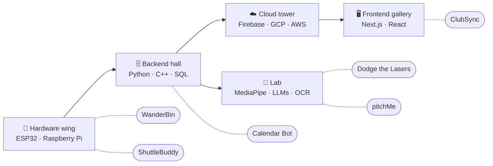
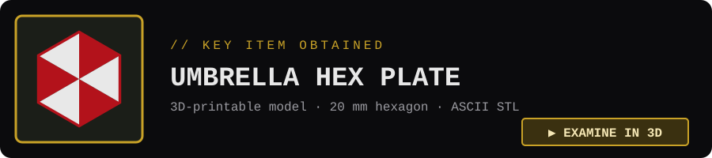

<p align="center">
  <picture>
    <source media="(prefers-color-scheme: dark)" srcset="assets/header-dark.svg">
    <source media="(prefers-color-scheme: light)" srcset="assets/header-light.svg">
    
  </picture>
</p>

<p align="center">
  <a href="https://raghavrajesh.com"><b>raghavrajesh.com</b></a> ·
  <a href="https://linkedin.com/in/raghav-rajesh"><b>LinkedIn</b></a>
</p>

**Computer Science & Design undergraduate at SUTD** and **AWS Certified Cloud Practitioner**. I build full-stack and backend systems, and I take them all the way down to the hardware.

- Shipped a membership, payments and attendance platform used across **90 SUTD clubs**
- Cut per-run ML analysis cost by **80–90%** (from $0.50–$1.00 to under $0.10)
- Built a timetable tool used by **150+ students**

## 📻 Field Reports

| Unit | Role | Report |
|---|---|---|
| **ClubSync**<br><sub>Feb – Aug 2026</sub> | Full-Stack Developer | Next.js / React / TypeScript platform for 90 clubs. Role-based access with Firestore Security Rules and Cloud Functions. OCR pipeline that checks PayNow receipts against fee records. |
| **pitchMe**<br><sub>Jan – Jun 2026</sub> | Technical Researcher | Multimodal video analysis (speech, body language, delivery) for presentation feedback. Moved MediaPipe into the browser and used late-fusion small language models to cut cost 80–90%. [Research ↗](https://github.com/raghav0818/SUTD-pitchMe-Mediapipe-Research) |

## 📂 Case Files

<table>
<tr>
<td width="50%" valign="top">

**🏸 ShuttleBuddy**<br>
<sub>Python · Telegram Bot API · Gemini · SQLite · Raspberry Pi</sub>

Automated badminton club fee collection. The bot sends each member a PayNow QR code and verifies payment screenshots: Gemini reads them, deterministic Python checks the numbers, and receipt fingerprints reject duplicates or edits. Runs 24/7 on a Pi 4.

<sub>🔒 Private repo · demo on request</sub>

</td>
<td width="50%" valign="top">

**📅 SUTD Calendar Bot**<br>
<sub>Python · Selenium · CustomTkinter · PyInstaller</sub>

Pulls the SUTD timetable out of the portal and exports `.ics` / `.csv` for Google and Apple Calendar. Desktop app with conflict resolution for overlapping classes. **Used by 150+ students.**

<sub>[View repo ↗](https://github.com/raghav0818/SUTD-CALENDAR-BOT)</sub>

</td>
</tr>
<tr>
<td width="50%" valign="top">

**🔴 Dodge the Lasers**<br>
<sub>Python · OpenCV · MediaPipe · NumPy · PyGame</sub>

Full-body motion game for the **SUTD Open House 2026** exhibit. Visitors appear as live silhouettes and dodge lasers. Threaded capture and inference plus vectorised collisions hold a steady 30 FPS.

<sub>[View repo ↗](https://github.com/raghav0818/SUTD-3DC-Openhouse-Project)</sub>

</td>
<td width="50%" valign="top">

**♻️ WanderBin**<br>
<sub>C++ · ESP32 · Arduino · PlatformIO · REST API</sub>

Firmware for an autonomous recycling bin. The ESP32 hosts its own WiFi access point and JSON REST API, so the web app drives it with no router or internet. The servo lid opens only for a detected hand **and** a "recyclable" verdict.

<sub>[View repo ↗](https://github.com/raghav0818/SUTD-IDEA-WANDERBIN-CODE)</sub>

</td>
</tr>
</table>

## 🗝️ Save Room

<sub>Optional files. Click to open.</sub>

<details>
<summary><b>🎒 Inventory</b>: skills in an attaché case</summary>
<br>

<p align="center"></p>

| Slot | Items |
|---|---|
| **Languages** | Python, TypeScript, JavaScript, C/C++, SQL, HTML, CSS |
| **Frameworks** | Next.js, React, Node.js, Selenium, OpenCV, MediaPipe, NumPy, Pandas |
| **Cloud & data** | Firebase, Firestore, Cloud Functions, GCP, PostgreSQL, SQLite, Linux, Git |
| **AI / ML** | LLMs, RAG, OCR |
| **Hardware** | ESP32, Raspberry Pi |
| **Key item** | AWS Certified Cloud Practitioner (Oct 2026) |

</details>

<details>
<summary><b>🌿 Combine</b>: how the items become projects</summary>
<br>

| Ingredients | | Result |
|---|:-:|---|
| Python + Telegram Bot API + Gemini vision + Raspberry Pi | ➜ | **ShuttleBuddy**: club treasury on autopilot |
| Python + Selenium + CustomTkinter | ➜ | **Calendar Bot**: timetable in your calendar in one click |
| OpenCV + MediaPipe + NumPy | ➜ | **Dodge the Lasers**: your body is the controller |
| C++ + ESP32 + REST API | ➜ | **WanderBin**: a bin with its own network |
| Next.js + Firebase + OCR | ➜ | **ClubSync**: 90 clubs, one platform |

</details>

<details>
<summary><b>🗺️ Mansion Map</b>: where each project lives</summary>
<br>



</details>

<details>
<summary><b>⌨️ Typewriter Log</b>: save history</summary>
<br>

```text
SAVE 01  2021–2022  St Andrew's Junior College ... GCE A-Level
SAVE 02  2025       SUTD ......................... B.Eng. Computer Science & Design
SAVE 03  2025–2026  WanderBin · SUTD Calendar Bot
SAVE 04  Jan 2026   pitchMe ...................... Technical Researcher
SAVE 05  Feb 2026   ClubSync ..................... Full-Stack Developer
SAVE 06  2026       ShuttleBuddy · Dodge the Lasers (Open House 2026)
SAVE 07  Oct 2026   AWS Certified Cloud Practitioner

INK RIBBONS REMAINING: ∞
```

</details>

<details>
<summary><b>🏅 Commendations</b></summary>
<br>

- **Founder & President, SUTD Toastmasters Club.** Founded SUTD's first Toastmasters-affiliated club, registered it with the Office of Student Life in one trimester, and grew it to 50+ active participants.
- **Hackathons:** Maritime Hackathon, Hack4Health Hackathon, and more.

</details>

<details>
<summary><b>🎭 Off Duty</b></summary>
<br>

Badminton (which is how ShuttleBuddy started) · LEGO · car spotting · urban exploration · solo travel · indie music

</details>

## 🔑 Key Item

<sub>Click to examine it in GitHub's 3D viewer: drag to rotate, scroll to zoom.</sub>

<a href="assets/key-item.stl"></a>

---

<p align="center"><sub><code>YOUR PROGRESS HAS BEEN SAVED.</code><br>Resident Evil is a Capcom property. This page is a fan tribute.</sub></p>
